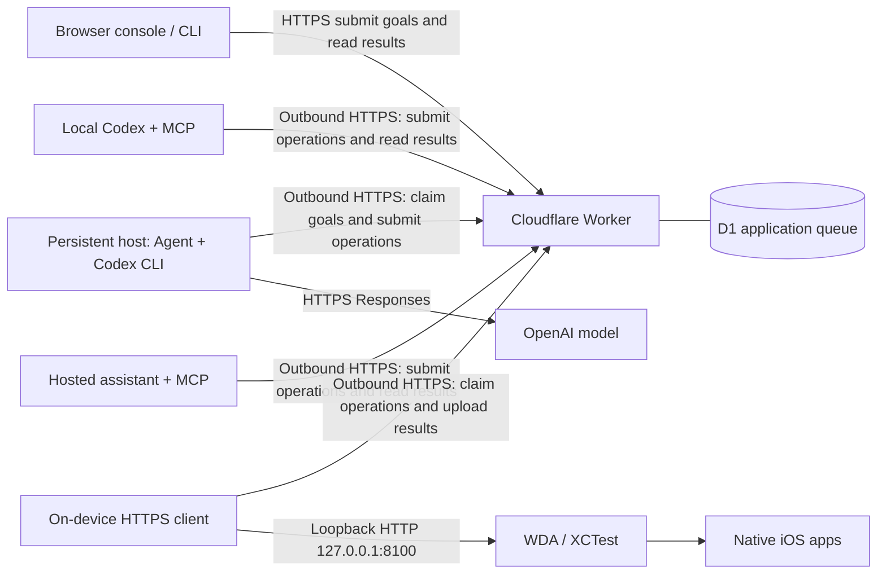

# iOS Remote Automation Agent

**English** | [简体中文](README.zh-CN.md)

Remote control and automate your iPad or iPhone from anywhere over HTTPS. Describe a task in natural language, let a persistent host or a hosted Bot plan the actions, and have an on-device WebDriverAgent runner carry them out and return screenshots.

**Prototype status:** tested on a physical iPad. iPhone compatibility has not yet been validated. The device must remain powered, connected and usable, with its WDA/XCTest session alive. Automatic recovery after a runner exit, device reboot or signing expiration is not implemented.

## What it does

- Runs natural-language device tasks from a browser console or CLI.
- Launches apps, reads accessibility state, taps, swipes, types and captures screenshots.
- Batches timing-sensitive gestures on the device, so auto-hiding controls do not have to wait for another model or network round trip.
- Uses outbound HTTPS requests from both the persistent host and the iOS device. No overlay VPN, router port forwarding or new inbound host listener is required.
- Separates controller, agent, device and optional Bot credentials, with a fixed-device operation allowlist.

A paired Mac is required for initial provisioning, building, signing, installation and recovery. Normal task execution uses the selected planner, the cloud queue and the iOS runner. The planner can be local Codex, a hosted assistant or the optional persistent host. Unplugged, cross-network execution has been tested; physically powering off the Mac has not yet been tested.

## How it works



Arrows show which component initiates a request. Queued work is delivered in the HTTP response. The queue is implemented in D1 with two job types: a natural-language `goal` for the agent, and a device `operation` for the runner. It does not use the Cloudflare Queues product.

In the optional persistent-host mode, the background agent polls roughly every 10 seconds, starts a restricted Codex CLI process, and exposes 10 device tools through stdio MCP. Local Codex and hosted assistants submit operations directly using their current model, with no background goal agent. The native HTTPS client is compiled into the WDA runner. Empty claims progressively hold the outbound HTTPS request for 5, 10 and 20 seconds, while the Worker checks D1 every 5 seconds. Queued work returns immediately; completed work resets the hold window and the next claim starts after 0.5 seconds. Heartbeats are persisted at most once per minute. See [polling and usage](docs/polling.md).

### Device-local action sequences

`ipad_sequence` executes up to 12 `tap` / `swipe` / `wait` steps on the device, then captures a screenshot and uploads the result once. There is no model inference, queue polling or cloud upload between steps.

This helps with transient UI, such as showing playback controls, seeking and capturing the resulting screen. The planned input and capture delay are limited to 8 seconds; actual wall-clock time includes system overhead. A sequence is not transactional: actions already performed cannot be rolled back, and uncertain actions must never be replayed automatically.

Existing service names and MCP tool names retain their `ipad-https-agent` and `ipad_` prefixes for compatibility. See [validation notes](docs/validation.md) for the scope of the iPad test; do not assume an arbitrary app or iPhone configuration has been certified.

## Hosted Bot alternative

The optional [hosted Bot adapter](bot/README.md) lets an assistant such as Grok Bot use the existing operation queue directly from its cloud computer. It provides task budgets and saved screenshot attachments without running Codex or the Devbox goal loop. It uses the assistant's own allowance and never enables additional paid usage. Register `bot/mcp.mjs` as a Command / stdio MCP connector and install the workflow in `bot/SKILL.md`; see the documented live acceptance result and verify your own platform before retiring another controller.

## Local Codex

The same task-aware adapter can be registered in local Codex as `home-ios`, with
`IPAD_CLIENT_KIND=codex` and its own optional `CODEX_TOKEN` runtime credential.
The current Codex chat plans the task and calls 13 MCP tools directly; no nested
Codex process or persistent-host agent is started. Local and hosted clients can
remain configured together, but must take turns operating the shared device.
See [local Codex setup and validation](local/README.md).

## Quick start

```bash
git clone --recurse-submodules https://github.com/leereliu/ios-remote-automation-agent.git
cd ios-remote-automation-agent
npm test
python3 -m compileall -q scripts
```

Local tests require Node.js 20.19 or later, Python 3 with SQLite and a C compiler. The deployment tested with the prototype used Node.js 22.16.0, Codex CLI 0.163.0, Xcode 26.3 and iPadOS 18.6.2. Python scripts use only the standard library. The background service targets Linux with user-level systemd.

These commands check the source; a working deployment additionally needs your own Cloudflare account, model authorization, Apple development signing and a paired device.

## Deployment overview

| Step | Script | Purpose |
| --- | --- | --- |
| Deploy the cloud queue | `scripts/deploy-cloud.py` | Create or reuse a Worker and D1 database; generate separate runtime keys in `.local/`. |
| Configure the persistent host | `scripts/configure-agent.py` | Render private Codex configuration and a systemd user service. |
| Build the device runner | `scripts/build-runner.py` | Copy the pinned WDA source, apply the integration patch and compile it. `--no-sign` performs a compile-only check. |
| Prepare a signed copy | `scripts/prepare-runner.py` | Produce a preinstalled runner without modifying the original Xcode build product. |
| Start the runner | `scripts/launch-device.py` | Launch through a paired Mac, passing device credentials through the environment. |
| Submit tasks | `scripts/control.mjs` | Read device status, submit goals and retrieve operation results. |

The full [deployment and recovery guide](docs/deployment.md) is currently in Simplified Chinese. Configuration examples are in [`config/`](config/); they contain placeholders only. Runtime files, model login state and signing material are not included.

Once configured, the controller CLI can be used like this:

```bash
node scripts/control.mjs status
node scripts/control.mjs op screenshot
node scripts/control.mjs goal 'Open Settings and take a screenshot'
node scripts/control.mjs wait goals TASK_UUID
node scripts/control.mjs wait operations OPERATION_UUID
```

The CLI reads `.local/queue-private.json` by default, or a private path specified by `IPAD_QUEUE_CONFIG`. Screenshots are written under the ignored `outputs/` directory. Keep controller credentials and credential-bearing QR codes private.

## What has been validated

On an 11-inch iPad Pro running iPadOS 18.6.2, the persistent host completed a new task after USB was disconnected and the Mac and iPad were on different networks. The task opened a specified video in the native Bilibili app, sought to 00:32, then to a displayed **05:00**, kept playback paused and captured the screen.

The task took 142.41 seconds across 8 MCP calls and 10 underlying operations. The final seek sequence took approximately 2470.1 ms from local input start to screenshot capture. This verifies the visible player timestamp and paused state, not an exact decoded frame timestamp.

The repository also passes automated queue, database, native polling policy and Bot contract tests and an unsigned WDA build from the pinned upstream source. Personal screenshots, device IDs, task logs and deployment credentials are excluded. See [validation details and remaining acceptance tests](docs/validation.md).

## Current limitations

- The runner must stay alive and the device must remain usable. Tapping the runner icon can crash during XCTest initialization; recovery currently requires a paired Mac.
- Free Apple Personal Team provisioning profiles normally expire after 7 days and require rebuilding and reinstalling. Longer signing validity alone does not solve process recovery.
- Overnight operation, lock-screen behavior, reboot recovery, long network outages and a physically powered-off Mac still need a complete acceptance matrix. iPhone validation is also pending.
- A goal marked `done` currently means Codex exited with code 0; business success still requires checking the reply and screenshot.
- Claimed jobs have no lease or reconciliation mechanism and can remain `running`. There is no per-goal device lock, so multiple controllers may interleave operations.
- Screenshots and accessibility text leave the device, are stored in the cloud and may be sent to the model. Automatic redaction, scheduled retention enforcement and a key-rotation UI are not implemented.
- Cloud cleanup is lazy and bounded; it does not guarantee deletion within 24 hours. The web console takes a current screenshot after goal completion rather than binding an immutable completion image to the goal.

The prototype can use free Cloudflare allowances and existing model-account quota, but it is not an unlimited free service. See [security and data boundaries](SECURITY.md) before using it with personal content.

## Design and provenance

The project began with an investigation and local experiment using [Qizhan7/wda-mcp](https://github.com/Qizhan7/wda-mcp). The current HTTPS architecture no longer uses that project's Python MCP server, Tailscale integration or remote-pairing implementation. This is an independent repository and does not copy its source or Git history.

Device automation uses [Appium WebDriverAgent](https://github.com/appium/WebDriverAgent), pinned as a submodule at `3d6a4e03cdd673e540289c610f7e189f8ffea434`. The integration patch is in [`patches/`](patches/), and the native HTTPS client is in [`device/`](device/). WDA development has moved to the [appium-ios monorepo](https://github.com/appium/appium-ios/tree/main/packages/webdriveragent); this project retains the tested upstream revision.

Further documentation is currently in Simplified Chinese:

- [Architecture, protocol, tradeoffs and open issues](docs/architecture.md)
- [Deployment and recovery](docs/deployment.md)
- [Validation record and acceptance matrix](docs/validation.md)

## License

New application code is licensed under MIT. WebDriverAgent and its integration patch retain the BSD-3-Clause terms. See [LICENSE](LICENSE) and [THIRD_PARTY_NOTICES.md](THIRD_PARTY_NOTICES.md).
