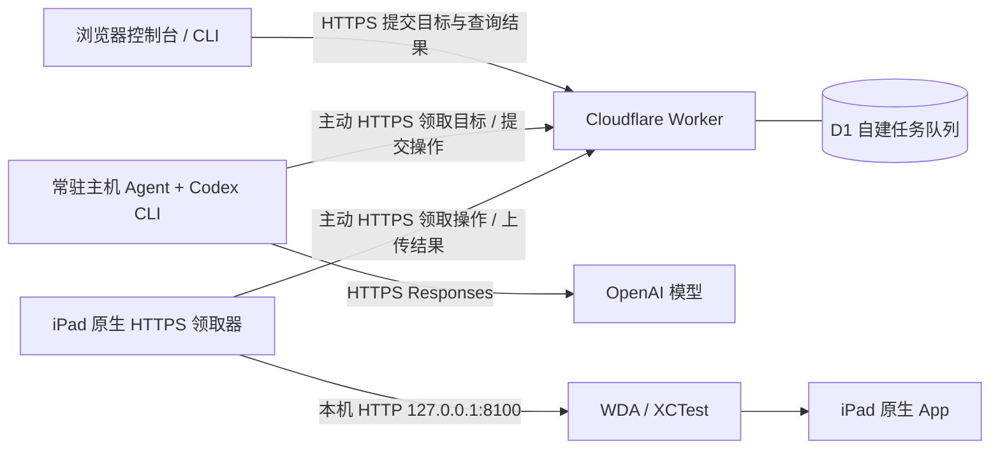

# iOS Remote Automation Agent

[English](README.md) | **简体中文**

通过 HTTPS，从任意地点用自然语言远程控制与自动化个人 iPad / iPhone。当前真机验收覆盖 iPad，iPhone 尚待验证。常驻主机运行 Codex CLI，iPad 主动通过 HTTPS 领取操作；无需在任务执行链路中运行 Mac，也无需安装组网软件或开放主机入站端口。

**状态：个人原型，已完成拔线与跨网络任务验收。执行器退出、设备重启、免费签名到期后的自动恢复尚未解决，不能承诺长期无人值守。**

## 当前实现



箭头表示请求发起方向；任务随云端 HTTP 响应交付。D1 上实现 `goal` 和 `operation` 两层队列，没有使用 Cloudflare Queues 产品。Mac 用于初次构建、签名、安装、启动及异常恢复。

- 后台 Agent 每约 10 秒领取自然语言目标，启动受限 Codex CLI，通过 stdio MCP 使用 10 个 iPad 工具。
- iPad 上的原生领取器编译进 WDA Runner，每约 5 秒领取操作，执行后上传结果。
- `ipad_sequence` 在设备本地连续执行最多 12 个 tap / swipe / wait，末尾截图并一次上传。步骤之间没有模型判断或云端往返。
- 独立 controller / agent / device 凭据、固定单设备、操作参数白名单；结果不确定时禁止自动重放触控。

[技术方案](docs/architecture.md) · [部署与恢复](docs/deployment.md) · [验证记录](docs/validation.md) · [安全与数据边界](SECURITY.md)

## 与最初 wda-mcp 方案的关系

最初调研并本地调整了 [Qizhan7/wda-mcp](https://github.com/Qizhan7/wda-mcp)。切换至“常驻 Agent + HTTPS 云端应用队列 + iPad 原生领取器”后，当前运行链路已不再使用其 Python MCP Server、Tailscale 或远程配对实现。本仓库为独立项目，没有复制该项目代码，也没有将其历史合并进来。

设备自动化依赖 [Appium WebDriverAgent](https://github.com/appium/WebDriverAgent)，以 Git submodule 固定在 `3d6a4e03cdd673e540289c610f7e189f8ffea434`。集成补丁位于 `patches/`，原生领取器位于 `device/`，许可证保留在 `third_party/`。该 WDA 仓库已迁移至 [appium-ios monorepo](https://github.com/appium/appium-ios/tree/main/packages/webdriveragent)；当前固定已验收版本，尚未迁移上游路径。

## 获取与本地校验

```bash
git clone --recurse-submodules https://github.com/leereliu/ios-remote-automation-agent.git
cd ios-remote-automation-agent
npm test
python3 -m compileall -q scripts
```

Node.js 20.19+ 可运行本地测试；后台部署验收环境使用 Node.js 22.16.0、Codex CLI 0.163.0、Xcode 26.3、iPadOS 18.6.2。Python 脚本仅使用标准库。

## 部署入口

1. `scripts/deploy-cloud.py`：部署带角色认证的 Cloudflare Worker 与 D1，私有状态保存到 `.local/`。
2. `scripts/configure-agent.py`：从私有配置生成后台主机的 Codex 配置和 systemd 单元。
3. `scripts/build-runner.py`：复制固定 WDA 源码，应用补丁并编译。支持 `--no-sign` 进行构建校验。
4. `scripts/prepare-runner.py`：对已签名产物制作预安装副本，保留 Xcode 原始产物。
5. `scripts/launch-device.py`：经已配对 Mac 启动 Runner；设备凭据通过环境传递。
6. `scripts/control.mjs`：提交目标、读取设备状态与截图。

具体命令及签名条件见 [部署说明](docs/deployment.md)。仓库仅包含示例配置，没有运行凭据、模型登录状态、真实设备标识、签名证书、截图或任务日志。

## 当前限制

- iPad 需持续供电、联网并保持可操作状态，WDA / XCTest 会话需要存活；手动打开 Runner 图标可能闪退，当前恢复需要已配对 Mac。
- 免费 Personal Team 签名通常 7 天到期，需要重新签名安装。
- 拔线任务已验证；Mac 物理关机、跨夜、锁屏、重启和长断网恢复尚未形成完整验收矩阵。
- `done` 当前仅表示 Codex 进程退出码为 0，业务成功需要另行核对截图和回复。
- 领取任务后缺少租约与自动对账，可能滞留 `running`。本地连续动作无法回滚，固定坐标无法保证任意 App 的操作成功率。
- 截图与界面文字会存入云端并提供给模型；目前缺少自动脱敏、定时清理和钥匙轮换界面。

## 许可证

本项目新增代码使用 MIT；WDA 与其集成补丁保留 BSD-3-Clause 条款。详见 [LICENSE](LICENSE) 和 [第三方说明](THIRD_PARTY_NOTICES.md)。
