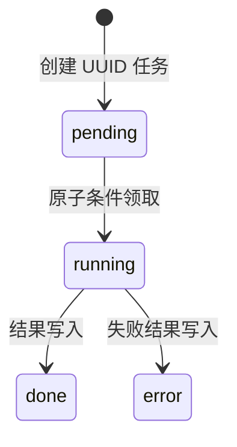
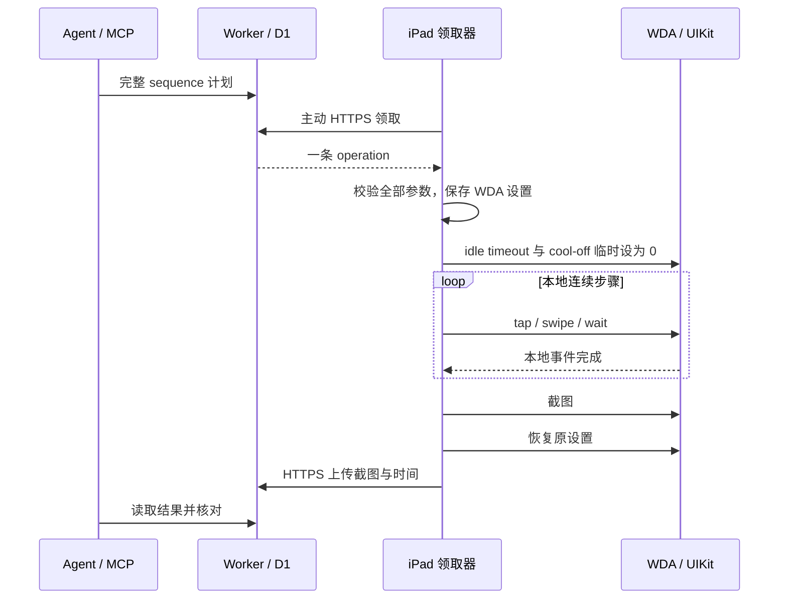

# iOS HTTPS 远程控制技术方案

更新于 2026-10-18。当前为单使用者、单设备、串行 Agent 原型。本文描述已经部署和实测的实现；发布整理中的通用化脚本与线上已部署路径存在配置方式差异，不表示这些脚本已经重新部署过现有环境。

## 目标与取舍

目标是让常驻主机在 Mac 离线期间处理个人 iPad 任务，复用已有设备和免费云服务。跨网络业务流使用 HTTPS 443。公司或家庭侧均无需新增公网入站服务；SSH 仅用于管理常驻主机。

| 方案 | 条件 | 当前取舍 |
| --- | --- | --- |
| Mac 直连 WDA | Mac 在线、USB 或可用开发者连接 | 用于部署和恢复 |
| Tailscale / ZeroTier | 终端网络组件与组织许可 | 当前链路已移除依赖 |
| 家庭常开主机 | 额外主机或可运行服务的路由器 | 本轮没有采用 |
| HTTPS 应用队列 | 常驻主机、云服务和 iPad 执行器存活 | 当前采用，接受轮询延迟与设备生命周期限制 |

当前入口为浏览器与 CLI，尚未接入 Telegram、飞书机器人或 OpenClaw。项目没有提供通用内网代理，也没有绕过组织策略的能力。常驻主机的使用需要符合所属组织的资源与数据规则。

## 组件与网络

整体架构见 [README](../README.md)。用户提交 `goal`；Agent 领取目标并拆成 `operation`；iPad 原生领取器领取操作、访问本机 WDA、上传结果；Agent 读图后决定下一次操作，最终回传文字结果。

| 组件 | 实现 | 主要职责 |
| --- | --- | --- |
| 云端 | `cloud/worker.mjs` + `schema.sql` | 角色鉴权、固定设备、操作白名单、任务状态与结果 |
| 网页 | `cloud/console-ui.mjs` | 提交目标、显示状态与截图；钥匙只驻留页面内存 |
| 后台 | `devbox/agent.mjs` | systemd 用户服务，串行领取目标，启动 Codex 子进程 |
| MCP | `devbox/mcp.mjs` + `queue-client.mjs` | stdio 工具、任务提交、结果查询、有限只读重试 |
| iPad | `device/FBHTTPSQueueClient.m` | 原生 HTTPS 领取器、WDA 调用、本地序列、结果持久化 |
| WDA 集成 | 固定 submodule + `patches/` | XCTest 提供截图、启动 App、触控与 UI XML |
| Mac 工具 | `scripts/` | 构建、签名副本、安装启动与恢复 |

Codex 使用独立 `CODEX_HOME`，关闭 Shell、Apps、插件、浏览器、电脑操作和多 Agent；模型访问使用 HTTPS Responses，关闭 WebSocket。只启用 10 个 iPad MCP 工具，每个目标最多 20 次工具调用、10 分钟子进程预算。此约束属于应用层能力限制，尚未形成独立虚拟机隔离或完成安全审计。

## 数据、权限与状态

`jobs` 保存 `id, kind, device_id, status, payload, result, created_at, expires_at, claimed_at, completed_at`。`kind` 为 `goal` 或 `operation`；`device_state` 保存 `last_seen` 与版本、运行时长元数据。

过期 pending 任务被跳过，但没有独立 expired 状态；running 不会因 TTL 自动回收，也没有取消接口。当前没有 `goal_id` 父子关联字段，审计关联需要辅助日志或时间范围。

| 接口 | 允许角色 |
| --- | --- |
| `POST /v1/goals` | controller |
| `GET /v1/goals/{id}` | controller、agent |
| `POST /v1/agent/claim`、`/v1/agent/result` | agent |
| `POST /v1/operations`、`GET /v1/operations/{id}` | controller、agent |
| `POST /v1/device/claim`、`/v1/device/result` | 固定 device |
| `GET /v1/device` | controller、agent |

Controller 可以直接操作设备，应按设备控制权限保护。部署用 Cloudflare 凭据与三类运行钥匙分离。请求采用静态 Bearer 认证；HTTP、未知操作/参数、任意 URL 与 Shell 操作被拒绝。原生客户端拒绝重定向，避免凭据被转交其他主机。

| 参数 | 当前值与语义 |
| --- | --- |
| goal TTL | 900 秒，控制未领取任务筛选 |
| operation TTL | 180 秒，领取与执行前检查 |
| Agent / iPad 空闲轮询 | 约 10 秒 / 5 秒，另加网络耗时 |
| 操作等待 / MCP 超时 | 150 秒 / 170 秒；超时不能证明动作没有发生 |
| JPEG | 点坐标尺寸，最多 500000 字节 |
| 结果 JSON | 设备端上限 780000 字节、云端上限 800000 字节 |
| UI XML | 超过 200000 字符截断 |

`done` 当前对应 Codex 进程退出码为 0，无法代替业务目标成功判断。需要增加独立的 success / failed / needs_user / unknown 业务结果与证据引用。

## 设备本地连续动作

自动隐藏的播放控件无法等待多轮模型推理。`ipad_sequence` 将完整短计划作为一条 operation 交给 iPad，按顺序调用多个本地 WDA 事件，让 UIKit 在步骤之间提交更新，最后截图并上传一次。

最多 12 步，只允许 tap / swipe / wait；计划输入与捕获等待合计最多 8 秒。单次 wait 与 capture delay 各最多 2000 毫秒。8 秒约束不包含全部系统开销，无法保证实际墙钟上限。Sequence 中 swipe duration 表示移动时长，初始按下保持 50 毫秒；独立 swipe 的 duration 表示按住时长，接口语义尚待统一。

失败会终止后续步骤；此前触控无法回滚。当前没有事务原子性或实时系统保证。05:00 样例通过两次拖动与短等待完成微调；播放器时间显示通过，解码帧恰好对应 300000 毫秒尚未认证。

## 幂等与失败恢复

相同 UUID、相同内容返回原任务，内容冲突返回 409。结果重复上传内容相同可接受，冲突返回 409。创建采用查询后插入，数据库主键防重复；并发相同键仍可能报错，因此不能承诺严格 exactly-once。

客户端只读查询最多重试 3 次；提交响应丢失时查询原 UUID，避免再提交触控。iPad 执行前记录 `received.json`，结果保存到 `pending.json` 后上传；上传失败只重传结果。领取响应丢失可能使任务滞留 running，当前缺少租约与对账。

控制台目标完成后会另取当前截图，尚未绑定该目标的不可变完成证据。多个控制台也可能交错提交，当前没有每设备 goal 锁。last_seen 来自设备领取，长动作期间可能被误判离线。

## 限制与改进优先级

| 优先级 | 问题 | 下一步 |
| --- | --- | --- |
| P0 | Runner 退出、重启、签名到期后需 Mac 恢复 | 生命周期探测、到期提示、明确人工恢复流程 |
| P0 | Mac 关机、锁屏、跨夜和长断网验收不足 | 先完成 24 小时、再扩展 72 小时矩阵 |
| P1 | running 滞留，结果未知 | 租约、阶段状态、对账；保持禁止自动重放 |
| P1 | done 与业务成功混用 | 结构化结果与不可变截图绑定 |
| P1 | 并发交错、goal/operation 关联不足 | 设备锁、父子 ID、独立心跳与耗时指标 |
| P1 | 坐标和 UI 时序敏感 | 可访问性定位、当前布局校准与状态验证 |
| P1 | 凭据和截图生命周期不足 | 钥匙轮换、定时清理、空间告警与内容范围约束 |
| P2 | 部署与入口面向维护者 | 版本发布、聊天入口、兼容性回归、多设备隔离 |

当前需要供电、联网、可操作且会话存活的 iPad。密码、验证码、付款与未经授权的消息发送由本人处理。DRM、缺少可访问性信息、App 更新和动画会影响操作与截图。手动点击 Runner 图标可能在 XCTest 初始化时闪退。

## 数据与免费额度

截图和 UI 文字会存入 D1、进入后台日志并提供给模型，目前没有自动脱敏。删除仅在新建任务时触发，每次最多删除 100 条“过期超过一天”的记录；空闲期间不触发，因此无法承诺 24 小时删除。恢复历史、导出和本地副本需要分别管理。

Cloudflare 当前免费额度为 Workers 100000 请求/天、CPU 10ms/请求；D1 读 500 万行/天、写 10 万行/天、账号 5GB、单库 500MB。按 Agent 10 秒和 iPad 5 秒轮询估算约 25920 请求/天，尚未包含目标执行、结果查询和网页轮询；设备心跳约 17280 次写入/天，实际额度需要观察指标。Codex 消耗已有账号额度，无法视为无限免费模型服务。

来源： [Workers limits](https://developers.cloudflare.com/workers/platform/limits/)、[D1 pricing](https://developers.cloudflare.com/d1/platform/pricing/)、[D1 limits](https://developers.cloudflare.com/d1/platform/limits/)。数据查阅于 2026-10-18。

## 发布、停止与回退

保留已验证 Runner 和配置版本；先检查状态、截图，再执行无副作用样例。停止后台服务会阻止领取新目标，正在 iPad 执行的动作仍可能完成。回退时恢复对应 Worker、Agent 与 Runner 版本；Runner 当前需要已配对 Mac。恢复验收需核对原任务状态和设备实际截图，避免重复结果未知的操作。

尚待决定：签名维护方式、重启后恢复要求、允许进入云端和模型的内容范围，以及常驻主机长期使用条件。
